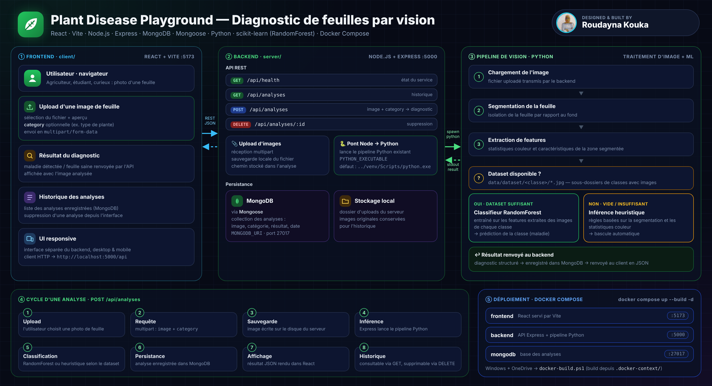

<div align="center">

# 🌿 Plant Disease Playground

**Application web full stack de diagnostic des maladies des plantes à partir d'une photo de feuille.**


</div>

---

## Sommaire

- [Présentation](#présentation)
- [Architecture](#architecture)
- [Fonctionnalités](#fonctionnalités)
- [Stack technique](#stack-technique)
- [Structure du projet](#structure-du-projet)
- [Démarrage rapide](#démarrage-rapide)
- [Lancer avec Docker Compose](#lancer-avec-docker-compose)
- [API REST](#api-rest)
- [Pipeline d'inférence](#pipeline-dinférence)
- [Feuille de route](#feuille-de-route)
- [Auteur](#auteur)

---

## Présentation

Plant Disease Playground permet de **téléverser une photo de feuille** et d'obtenir un **diagnostic** de son état (maladie détectée ou feuille saine). Les analyses sont enregistrées et consultables dans un historique.

Le projet a été **migré d'un prototype Python vers une architecture full stack** :

- **`client/`** : interface **React** (Vite), responsive et séparée du backend ;
- **`server/`** : API **Node.js / Express** qui reçoit les images, appelle le pipeline Python et enregistre les résultats dans **MongoDB** ;
- **pipeline Python** : traitement d'image et classification. Il réutilise le code Python d'origine, conservé dans le dépôt comme référence technique.

---

## Architecture



**Cycle d'une analyse** :
1. Le client envoie l'image en `multipart/form-data`.
2. Express sauvegarde le fichier localement et lance le pipeline Python.
3. Le pipeline segmente la feuille, extrait les caractéristiques et classe l'image : **RandomForest** si un dataset est disponible, **heuristique** sinon.
4. Le résultat est enregistré dans MongoDB puis renvoyé en JSON à l'interface React.

---

## Fonctionnalités

| Fonctionnalité | Détail |
|---|---|
| 📤 **Upload d'image** | Téléversement d'une photo de feuille, avec une catégorie optionnelle |
| 🔬 **Inférence réelle** | Appel du pipeline Python de traitement d'image existant |
| 🧠 **Classification adaptative** | RandomForest entraîné sur le dataset local, ou heuristique couleur et segmentation en repli automatique |
| 🗂️ **Historique** | Liste des analyses enregistrées dans MongoDB, avec suppression |
| 💾 **Stockage des images** | Sauvegarde locale des images téléversées |
| 📱 **Interface responsive** | Frontend React propre, séparé du backend |
| 🐳 **Conteneurisation** | Frontend, backend et MongoDB orchestrés par Docker Compose |

---

## Stack technique

| Couche | Technologies |
|---|---|
| **Frontend** | React, Vite |
| **Backend** | Node.js, Express, upload `multipart/form-data` |
| **Base de données** | MongoDB, Mongoose |
| **Vision & ML** | Python : segmentation d'image, extraction de caractéristiques couleur, scikit-learn (RandomForest) |
| **DevOps** | Docker, Docker Compose, script PowerShell de build |

---

## Structure du projet

```text
plant-disease-playground/
├── client/                 # Frontend React (Vite)
├── server/                 # API Express + MongoDB + upload d'images
│   └── .env.example        # modèle de configuration
├── data/
│   └── dataset/            # (optionnel) un sous-dossier par classe, contenant des images
├── docker-compose.yml      # frontend + backend + mongodb
├── docker-build.ps1        # build Docker depuis une copie hors OneDrive (Windows)
└── ...                     # ancien code Python (pipeline de traitement d'image, référence)
```

---

## Démarrage rapide

### Prérequis

- Node.js et npm
- MongoDB (local ou Atlas)
- Python avec un environnement virtuel `venv` contenant les dépendances du pipeline

### 1. Backend

```bash
cd server
cp .env.example .env      # puis renseigner au minimum MONGODB_URI
npm install
npm run dev
```

| Variable | Rôle | Valeur par défaut |
|---|---|---|
| `MONGODB_URI` | Connexion MongoDB (**obligatoire**) | — |
| `PYTHON_EXECUTABLE` | Interpréteur Python utilisé pour le pipeline | `../venv/Scripts/python.exe` |

> Le chemin par défaut correspond à un `venv` Windows. Sous Linux / macOS, utilisez par exemple `PYTHON_EXECUTABLE=../venv/bin/python`.

### 2. Frontend

```bash
cd client
npm install
npm run dev
```

- Interface : <http://localhost:5173>
- API : <http://localhost:5000>

---

## Lancer avec Docker Compose

```bash
docker compose up --build -d
```

| Service | URL |
|---|---|
| frontend | <http://localhost:5173> |
| backend | <http://localhost:5000> |
| mongodb | `mongodb://localhost:27017` |

Arrêt :

```bash
docker compose down
```

> **Windows + OneDrive** : si le dépôt est dans OneDrive, Docker BuildKit peut échouer sur les fichiers `ReparsePoint` (erreur `invalid file request`). Lancez alors depuis la racine du projet :
>
> ```powershell
> .\docker-build.ps1
> ```
>
> Le script crée une copie de travail normale dans `.docker-context/`, puis exécute `docker compose up --build -d` depuis cette copie.

---

## API REST

| Méthode | Endpoint | Description |
|---|---|---|
| `GET` | `/api/health` | État du service |
| `GET` | `/api/analyses` | Historique des analyses |
| `POST` | `/api/analyses` | Nouvelle analyse (upload + inférence) |
| `DELETE` | `/api/analyses/:id` | Suppression d'une analyse |

`POST /api/analyses` attend un formulaire `multipart/form-data` contenant :

| Champ | Type | Obligatoire |
|---|---|---|
| `image` | fichier image | ✅ |
| `category` | texte | ❌ |

Exemple :

```bash
curl -X POST http://localhost:5000/api/analyses \
  -F "image=@feuille.jpg" \
  -F "category=tomate"
```

---

## Pipeline d'inférence

1. **Chargement** de l'image téléversée.
2. **Segmentation** de la feuille par rapport au fond.
3. **Extraction de caractéristiques** : statistiques couleur et caractéristiques de la zone segmentée.
4. **Classification** :
   - si `data/dataset/` contient des **sous-dossiers de classes avec des images**, le backend utilise un **RandomForest** entraîné sur les caractéristiques extraites ;
   - si le dataset est **vide ou insuffisant**, il bascule **automatiquement** sur une **inférence heuristique** basée sur la segmentation et les statistiques couleur.

Organisation attendue du dataset :

```text
data/dataset/
├── <classe_1>/   ex. healthy/
│   ├── img001.jpg
│   └── ...
└── <classe_2>/   ex. early_blight/
    └── ...
```

---

## Feuille de route

- [ ] Afficher un score de confiance avec chaque prédiction
- [ ] Remplacer le RandomForest par un CNN (transfer learning, ex. MobileNet / EfficientNet) entraîné sur PlantVillage
- [ ] Exposer le pipeline Python comme microservice (FastAPI) au lieu d'un appel de processus
- [ ] Stocker les images dans un stockage objet (S3 / Azure Blob)
- [ ] Ajouter des tests (API, pipeline) et une CI (lint, tests, build des images Docker)
- [ ] Authentification et historique par utilisateur

---

## Auteur

**Roudayna Kouka** — étudiante en génie logiciel (FST), Full Stack · Cloud · DevOps
GitHub : [@roudayn-kouka](https://github.com/roudayn-kouka)
